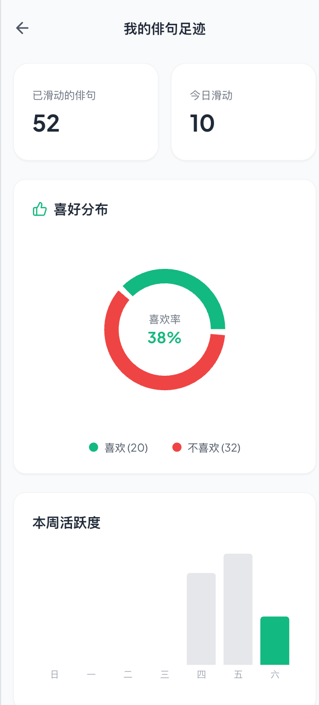

<p align="right"><a href="README.md">中文</a></p>

<p align="center">
  
</p>

<p align="center">
  <a href="https://xiaosang.cc/haiku-flow/">▶ Try Online</a>
  ·
  <a href="https://github.com/holynova/haiku-flow">GitHub Repository</a>
</p>

Haiku Flow is a minimalist haiku discovery app: read haiku like swiping cards — swipe right to like, left to pass. 410 haiku in the deck; each swiped card recycles to the back, so the poetry never runs out. Likes go to your Favorites, and the Stats page tracks how much you've read and liked. Everything lives in local browser storage — no account needed.

## Screenshots

<p align="center">
  
  
</p>

## Features

- **Swipe to discover**: drag cards or tap the buttons; Framer Motion powers the swipe and spring-back animation.
- **Infinite loop**: swiped cards recycle to the back of the deck; the shuffled deck order persists in localStorage, so a refresh picks up where you left off.
- **410 haiku**: attributed to Matsuo Bashō, Yosa Buson, Santōka Taneda, and Kobayashi Issa (about 100 each), plus a 5-poem classic selection with Japanese original, romaji, and English translation (e.g. Bashō's Old Pond).
- **Favorites**: liked haiku are collected automatically, browsable in list or grid view, removable anytime.
- **Reading stats**: total swipes, today's swipes, likes and passes, and a 7-day activity bar chart (Recharts) — all from local records.

## Run Locally

```bash
npm install
npm run dev      # development server
npm run build    # production build
npm run preview  # preview the build output
```

Pure frontend, no backend, no account, all data local.

## Tech

- React 19 + TypeScript + Vite + Tailwind CSS 4, React Router 7 (three pages: Home / Favorites / Stats).
- Swiping and page transitions: Framer Motion; stats charts: Recharts; icons: Lucide.
- Data: `src/data.ts` (410-poem deck + 5-poem classic selection); the original merge scripts and DeepSeek export JSONs are kept under `data/`.

```
src/App.tsx            Routing: / Home, /stats Stats, /favorites Favorites
src/pages/Home.tsx     Swipe home page
src/pages/Favorites.tsx Favorites (list / grid views)
src/pages/Stats.tsx    Reading stats (Recharts bar chart)
src/components/SwipeCard.tsx  Draggable haiku card
src/hooks/useDeck.ts   Deck: shuffle, loop recycling, localStorage persistence
src/hooks/useHaikuStats.ts  Stats: swipe log, likes/passes, last-7-days activity
src/data.ts            410 haiku + 5-poem classic selection
```
