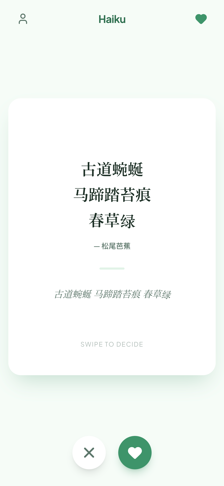

<p align="center">
  
</p>

<p align="center">
  <a href="https://xiaosang.cc/haiku-flow/">▶ 在线体验 Try Online</a>
  ·
  <a href="https://github.com/holynova/haiku-flow">GitHub 仓库</a>
</p>

Haiku Flow 是一款极简的俳句发现应用：像刷卡片一样读俳句，右滑喜欢、左滑跳过。收录 410 首俳句，滑过的卡片自动回到队尾，诗歌永不枯竭；喜欢的进收藏夹，读了多少、喜欢多少，统计页都记着。全部数据存在本地浏览器，不用账号。

Haiku Flow is a minimalist haiku discovery app: read haiku like swiping cards — swipe right to like, left to pass. 410 haiku in the deck; each swiped card recycles to the back, so the poetry never runs out. Likes go to your Favorites, and the Stats page tracks how much you've read and liked. Everything lives in local browser storage — no account needed.

## 截图 / Screenshots

<p align="center">
  
  
</p>

## 功能 / Features

- **滑动发现**：拖拽卡片或点底部按钮，右滑喜欢、左滑跳过；Framer Motion 驱动的滑动与回弹动画。
- **无限循环**：滑过的卡片自动回到队尾；牌组顺序洗牌后存入 localStorage，刷新页面接着读。
- **410 首俳句**：署名松尾芭蕉、与谢芜村、种田山头火、小林一茶（各约 100 首），另有 5 首带日文原文、罗马音与英译的经典选本（如芭蕉《古池》）。
- **收藏夹**：右滑喜欢的俳句自动收藏，可列表 / 网格两种视图浏览，可取消收藏。
- **阅读统计**：总滑动、今日滑动、喜欢与跳过数，以及近 7 天活动柱状图（Recharts），全部来自本地记录。

## 本地运行 / Run Locally

```bash
npm install
npm run dev      # 开发服务器
npm run build    # 生产构建
npm run preview  # 预览构建产物
```

纯前端应用，无后端、无账号，数据全在本地。

## 技术 / Tech

- React 19 + TypeScript + Vite + Tailwind CSS 4，React Router 7（三页：首页 / 收藏 / 统计）。
- 滑动与页面转场：Framer Motion；统计图表：Recharts；图标：Lucide。
- 数据：`src/data.ts`（410 首牌组 + 5 首经典选本），`data/` 下保留了原始合并脚本与 DeepSeek 导出 JSON。

```
src/App.tsx            路由：/ 首页 /stats 统计 /favorites 收藏
src/pages/Home.tsx     滑动主页
src/pages/Favorites.tsx 收藏夹（列表 / 网格视图）
src/pages/Stats.tsx    阅读统计（Recharts 柱状图）
src/components/SwipeCard.tsx  可拖拽俳句卡片
src/hooks/useDeck.ts   牌组：洗牌、循环回收、localStorage 持久化
src/hooks/useHaikuStats.ts  统计：滑动记录、喜欢/跳过、近 7 天活动
src/data.ts            410 首俳句 + 5 首经典选本
```

## English

**Haiku Flow** is a minimalist haiku discovery app with a Tinder-style swipe interface: swipe right to like, left to pass.

- **Swipe to discover**: drag cards or tap the buttons; Framer Motion powers the swipe and spring-back animation.
- **Infinite loop**: swiped cards recycle to the back of the deck; the shuffled deck order persists in localStorage, so a refresh picks up where you left off.
- **410 haiku**: attributed to Matsuo Bashō, Yosa Buson, Santōka Taneda, and Kobayashi Issa (about 100 each), plus a 5-poem classic selection with Japanese original, romaji, and English translation (e.g. Bashō's Old Pond).
- **Favorites**: liked haiku are collected automatically, browsable in list or grid view, removable anytime.
- **Reading stats**: total swipes, today's swipes, likes and passes, and a 7-day activity bar chart (Recharts) — all from local records.
- **Run it**: `npm install && npm run dev`. Pure frontend, no backend, no account.
- **Tech**: React 19 + TypeScript + Vite + Tailwind CSS 4, React Router 7, Framer Motion, Recharts, Lucide icons. Data in `src/data.ts`; raw merge scripts and DeepSeek export JSONs are kept under `data/`.

## 许可 / License

本仓库暂未声明开源许可。
